# Multilingual Neural Text-to-Speech

### FastSpeech 2 | English & Telugu


**A multilingual Text-to-Speech research implementation based on FastSpeech 2, covering English and Telugu speech generation.**

This repository brings together language-specific data preparation, acoustic-model training, inference pipelines, model checkpoints, generated speech samples, and experiment visualizations.

**Implemented languages:**

| Language | Dataset | Implementation | Model checkpoints |
|---|---|---|---|
| English | AI4Bharat Svarah | [`English/`](English/) | [Hugging Face](https://huggingface.co/Hanushree/fastspeech2-svarah-english) |
| Telugu | IndicTTS | [`Telugu/`](Telugu/) | [Hugging Face](https://huggingface.co/Hanushree/fastspeech2-telugu-v2) |

---

## Table of Contents

- [Project Overview](#project-overview)
- [Architecture](#architecture)
- [Repository Organization](#repository-organization)
- [Datasets and Language Pipelines](#datasets-and-language-pipelines)
- [Model Checkpoints](#model-checkpoints)
- [Training Experiments](#training-experiments)
- [Generated Speech Samples](#generated-speech-samples)
- [Variance Adaptor Analysis](#variance-adaptor-analysis)
- [Installation](#installation)
- [Reproducibility](#reproducibility)
- [Technical Report](#technical-report)
- [Acknowledgements](#acknowledgements)

---

## Project Overview

Text-to-Speech (TTS) converts written language into natural-sounding speech. This project implements FastSpeech 2 for two languages, with separate data-processing and configuration pipelines.

FastSpeech 2 is a non-autoregressive acoustic model. It uses explicit duration, pitch, and energy representations to improve speech generation and provide control over important prosodic characteristics.

### Project objectives

- Develop separate English and Telugu TTS pipelines.
- Prepare language-specific text and speech data.
- Train FastSpeech 2 acoustic models using configurable parameters.
- Generate mel-spectrograms from input text.
- Convert predicted mel-spectrograms into audio using HiFi-GAN.
- Examine training behaviour and variance-adaptor predictions.

## Architecture

The overall text-to-speech pipeline is:

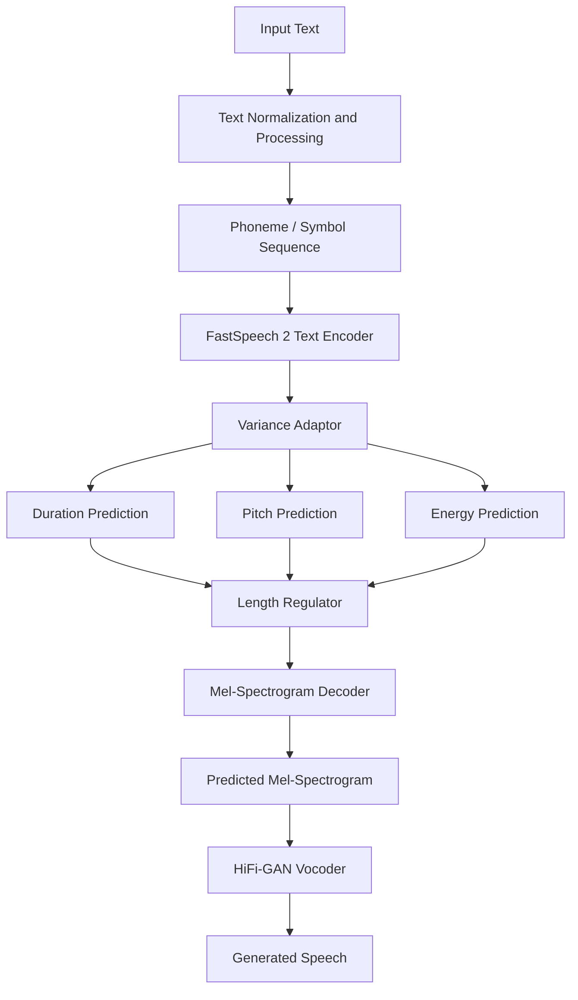

### Main components

| Component | Responsibility |
|---|---|
| Text processing | Converts input text into the model's supported sequence representation. |
| Text encoder | Encodes linguistic input into hidden representations. |
| Duration predictor | Estimates the duration of input tokens or phonemes. |
| Pitch predictor | Models pitch-related information. |
| Energy predictor | Models speech energy. |
| Length regulator | Expands encoder representations according to predicted durations. |
| Mel decoder | Generates the acoustic mel-spectrogram. |
| HiFi-GAN | Converts mel-spectrograms into waveform audio. |

## Repository Organization

```text
fastspeech2-tts-english-telugu/
│
├── English/
│   ├── audio/
│   ├── checkpoints/
│   ├── config/
│   ├── hifigan/
│   ├── lexicon/
│   ├── model/
│   ├── text/
│   ├── utils/
│   ├── dataset.py
│   ├── preprocess.py
│   ├── train.py
│   ├── inference.py
│   └── synthesize.py
│
├── Telugu/
│   ├── audio/
│   ├── checkpoints/
│   ├── config/
│   ├── hifigan/
│   ├── lexicon/
│   ├── model/
│   ├── text/
│   ├── utils/
│   ├── dataset.py
│   ├── preprocess.py
│   ├── train.py
│   ├── inference.py
│   └── synthesize.py
│
├── Results/
│   ├── English/
│   │   ├── training_loss.png
│   │   ├── validation_loss.png
│   │   ├── test_generated_audios/
│   │   └── variance_adaptor_plots/
│   └── Telugu/
│       ├── training_loss.png
│       ├── validation_loss.png
│       ├── test_generated_audios/
│       └── variance_adaptor_plots/
│
├── Report/
├── requirements.txt
└── README.md
```

## Datasets and Language Pipelines

### English — Svarah

The English pipeline uses the AI4Bharat Svarah speech dataset. The language-specific preprocessing and training configuration are maintained under `English/`.

### Telugu — IndicTTS

The Telugu pipeline uses the IndicTTS dataset. Its preprocessing, language configuration, training code, and inference implementation are maintained separately under `Telugu/`.

Each language has its own configuration files. Refer to the respective `config/` directory for the actual preprocessing, model, and training settings.

## Model Checkpoints

Trained model checkpoints are hosted on Hugging Face to avoid GitHub's large-file limitations.

### English checkpoints

Model repository: [Hanushree/fastspeech2-svarah-english](https://huggingface.co/Hanushree/fastspeech2-svarah-english)

| Training step | Checkpoint |
|---:|---|
| 5,000 | [5000.pth.tar](https://huggingface.co/Hanushree/fastspeech2-svarah-english/resolve/main/5000.pth.tar) |
| 10,000 | [10000.pth.tar](https://huggingface.co/Hanushree/fastspeech2-svarah-english/resolve/main/10000.pth.tar) |
| 15,000 | [15000.pth.tar](https://huggingface.co/Hanushree/fastspeech2-svarah-english/resolve/main/15000.pth.tar) |
| 20,000 | [20000.pth.tar](https://huggingface.co/Hanushree/fastspeech2-svarah-english/resolve/main/20000.pth.tar) |
| 25,000 | [25000.pth.tar](https://huggingface.co/Hanushree/fastspeech2-svarah-english/resolve/main/25000.pth.tar) |
| 30,000 | [30000.pth.tar](https://huggingface.co/Hanushree/fastspeech2-svarah-english/resolve/main/30000.pth.tar) |

### Telugu checkpoints

Model repository: [Hanushree/fastspeech2-telugu-v2](https://huggingface.co/Hanushree/fastspeech2-telugu-v2)

| Training step | Checkpoint |
|---:|---|
| 1,000 | [1000.pth.tar](https://huggingface.co/Hanushree/fastspeech2-telugu-v2/resolve/main/1000.pth.tar) |
| 2,000 | [2000.pth.tar](https://huggingface.co/Hanushree/fastspeech2-telugu-v2/resolve/main/2000.pth.tar) |
| 3,000 | [3000.pth.tar](https://huggingface.co/Hanushree/fastspeech2-telugu-v2/resolve/main/3000.pth.tar) |
| 4,000 | [4000.pth.tar](https://huggingface.co/Hanushree/fastspeech2-telugu-v2/resolve/main/4000.pth.tar) |
| 5,000 | [5000.pth.tar](https://huggingface.co/Hanushree/fastspeech2-telugu-v2/resolve/main/5000.pth.tar) |
| 6,000 | [6000.pth.tar](https://huggingface.co/Hanushree/fastspeech2-telugu-v2/resolve/main/6000.pth.tar) |
| 7,000 | [7000.pth.tar](https://huggingface.co/Hanushree/fastspeech2-telugu-v2/resolve/main/7000.pth.tar) |
| 8,000 | [8000.pth.tar](https://huggingface.co/Hanushree/fastspeech2-telugu-v2/resolve/main/8000.pth.tar) |
| 9,000 | [9000.pth.tar](https://huggingface.co/Hanushree/fastspeech2-telugu-v2/resolve/main/9000.pth.tar) |
| 10,000 | [10000.pth.tar](https://huggingface.co/Hanushree/fastspeech2-telugu-v2/resolve/main/10000.pth.tar) |
| 11,000 | [11000.pth.tar](https://huggingface.co/Hanushree/fastspeech2-telugu-v2/resolve/main/11000.pth.tar) |
| 12,000 | [12000.pth.tar](https://huggingface.co/Hanushree/fastspeech2-telugu-v2/resolve/main/12000.pth.tar) |
| 13,000 | [13000.pth.tar](https://huggingface.co/Hanushree/fastspeech2-telugu-v2/resolve/main/13000.pth.tar) |
| 14,000 | [14000.pth.tar](https://huggingface.co/Hanushree/fastspeech2-telugu-v2/resolve/main/14000.pth.tar) |
| 15,000 | [15000.pth.tar](https://huggingface.co/Hanushree/fastspeech2-telugu-v2/resolve/main/15000.pth.tar) |
| 16,000 | [16000.pth.tar](https://huggingface.co/Hanushree/fastspeech2-telugu-v2/resolve/main/16000.pth.tar) |
| 17,000 | [17000.pth.tar](https://huggingface.co/Hanushree/fastspeech2-telugu-v2/resolve/main/17000.pth.tar) |
| 18,000 | [18000.pth.tar](https://huggingface.co/Hanushree/fastspeech2-telugu-v2/resolve/main/18000.pth.tar) |
| 19,000 | [19000.pth.tar](https://huggingface.co/Hanushree/fastspeech2-telugu-v2/resolve/main/19000.pth.tar) |
| 20,000 | [20000.pth.tar](https://huggingface.co/Hanushree/fastspeech2-telugu-v2/resolve/main/20000.pth.tar) |

See [`English/checkpoints/`](English/checkpoints/) and [`Telugu/checkpoints/`](Telugu/checkpoints/) for language-specific checkpoint documentation.

---

## Experimental Results & Visual Gallery

Explore the training behaviour, generated speech samples, and
variance-adaptor predictions for both language implementations.

<p align="center">
<b>ENGLISH</b> &nbsp; | &nbsp; <b>TELUGU</b>
</p>

---

## 1. Training & Validation Analysis

Training and validation curves provide a visual overview of model
optimization and generalization behaviour.

### English

<details open>
<summary><b>Training Loss</b></summary>

<table width="100%">
<tr>
<td width="50%" align="center" valign="top"><b>Training Loss</b><br><br>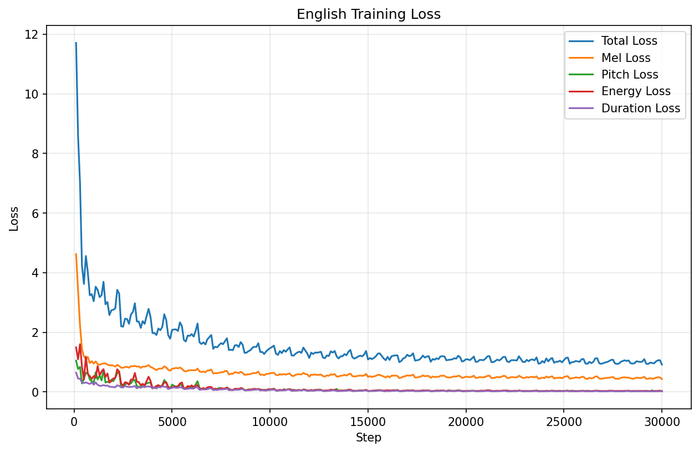<br><sub><code>training_loss.png</code></sub></td>
<td width="50%"></td>
</tr>
</table>

</details>

<details open>
<summary><b>Validation Loss</b></summary>

<table width="100%">
<tr>
<td width="50%" align="center" valign="top"><b>Validation Loss</b><br><br>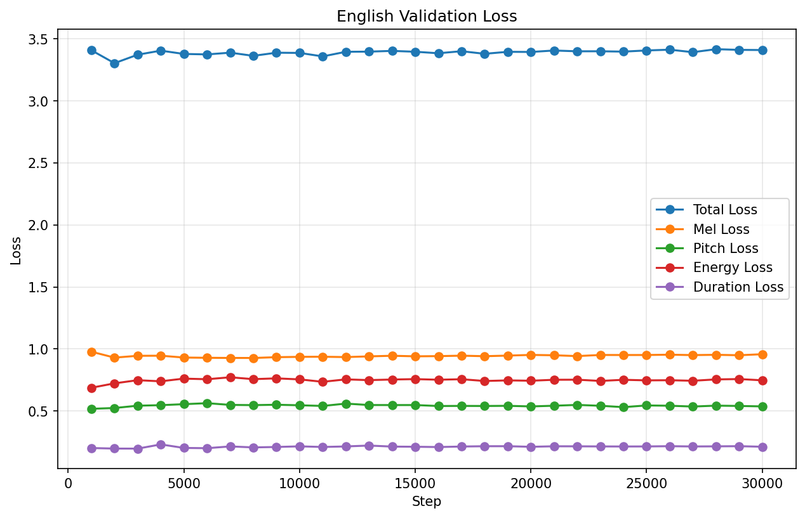<br><sub><code>validation_loss.png</code></sub></td>
<td width="50%"></td>
</tr>
</table>

</details>

<details>
<summary><b>Additional Experiment Graphs</b></summary>

<table width="100%">
<tr>
<td width="50%" align="center" valign="top"><b>Checkpoint Progression</b><br><br>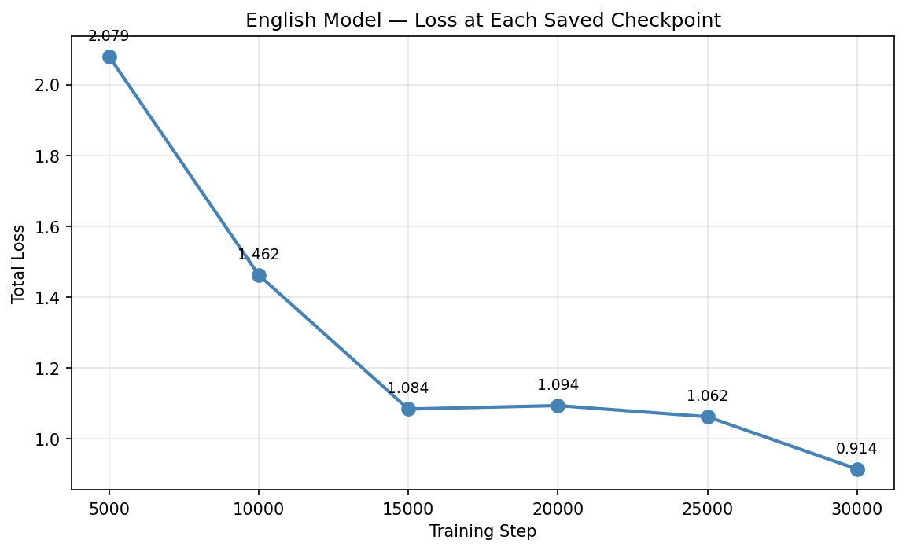<br><sub><code>checkpoint_progression.png</code></sub></td>
<td width="50%" align="center" valign="top"><b>E1 Spectrogram</b><br><br>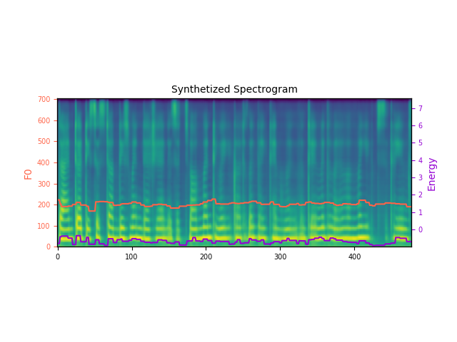<br><sub><code>E1_spectrogram.png</code></sub></td>
</tr>
</table>

<table width="100%">
<tr>
<td width="50%" align="center" valign="top"><b>E2A Spectrogram</b><br><br>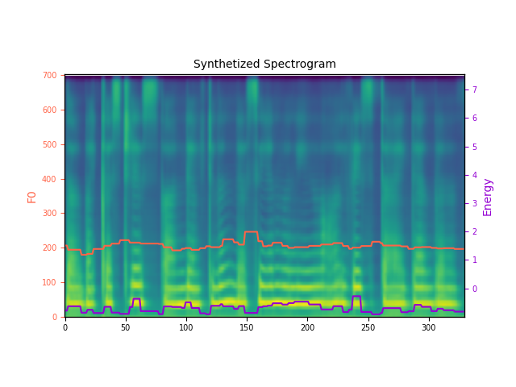<br><sub><code>E2a_spectrogram.png</code></sub></td>
<td width="50%" align="center" valign="top"><b>E2B Spectrogram</b><br><br>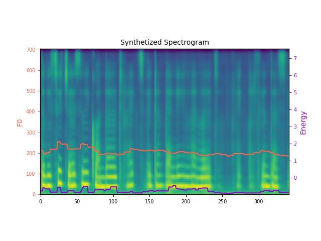<br><sub><code>E2b_spectrogram.png</code></sub></td>
</tr>
</table>

<table width="100%">
<tr>
<td width="50%" align="center" valign="top"><b>E3 Spectrogram</b><br><br>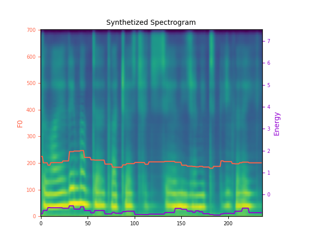<br><sub><code>E3_spectrogram.png</code></sub></td>
<td width="50%" align="center" valign="top"><b>E4 Spectrogram</b><br><br>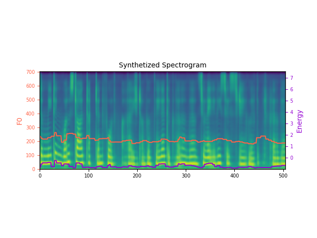<br><sub><code>E4_spectrogram.png</code></sub></td>
</tr>
</table>

<table width="100%">
<tr>
<td width="50%" align="center" valign="top"><b>E1 Duration</b><br><br>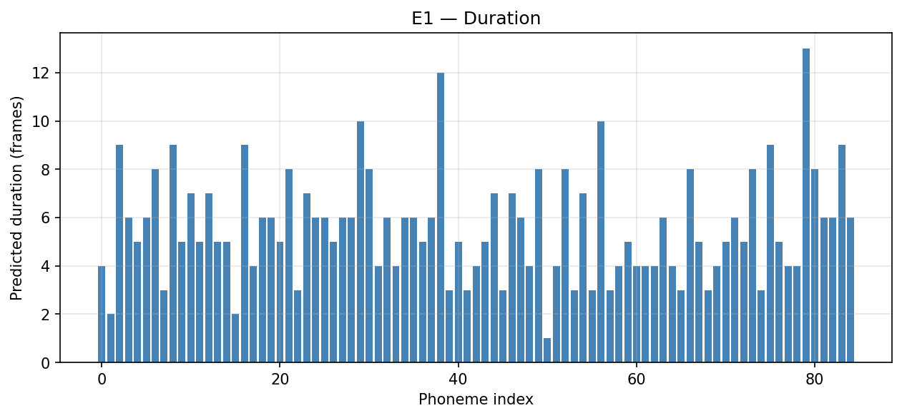<br><sub><code>E1_duration.png</code></sub></td>
<td width="50%" align="center" valign="top"><b>E2A Duration</b><br><br>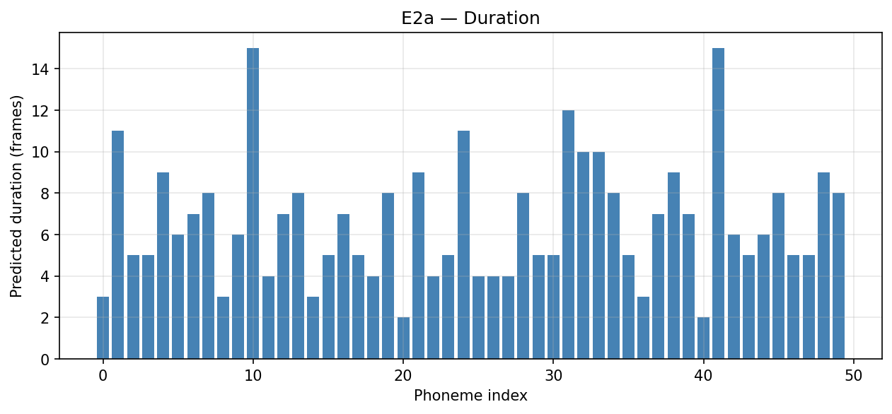<br><sub><code>E2a_duration.png</code></sub></td>
</tr>
</table>

<table width="100%">
<tr>
<td width="50%" align="center" valign="top"><b>E2B Duration</b><br><br>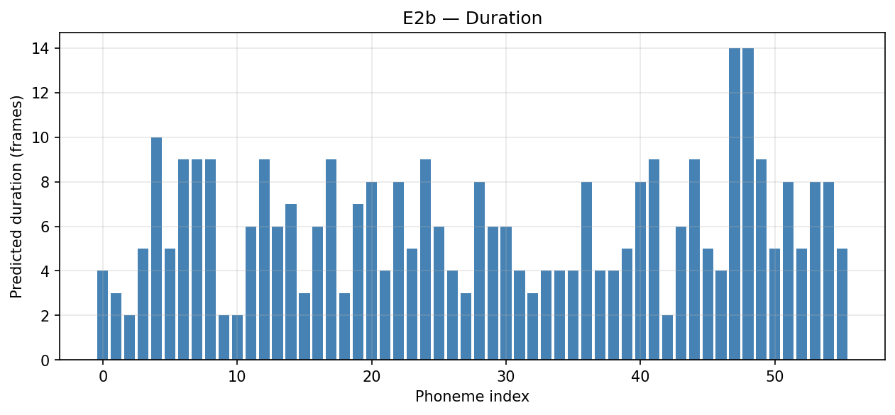<br><sub><code>E2b_duration.png</code></sub></td>
<td width="50%" align="center" valign="top"><b>E3 Duration</b><br><br>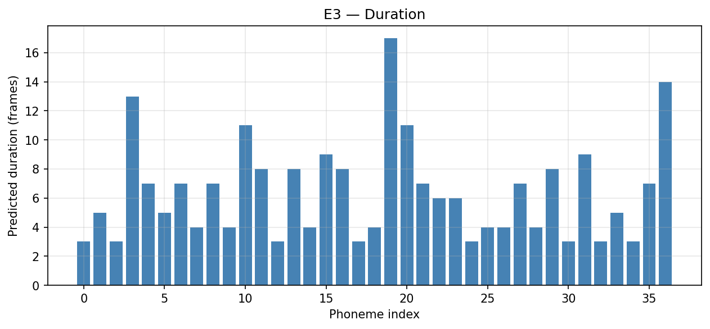<br><sub><code>E3_duration.png</code></sub></td>
</tr>
</table>

<table width="100%">
<tr>
<td width="50%" align="center" valign="top"><b>E4 Duration</b><br><br>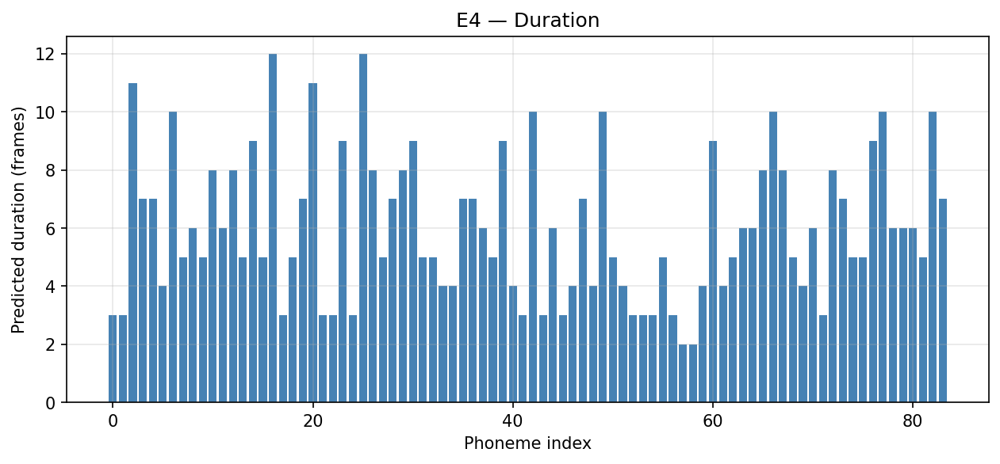<br><sub><code>E4_duration.png</code></sub></td>
<td width="50%" align="center" valign="top"><b>E1 Energy</b><br><br>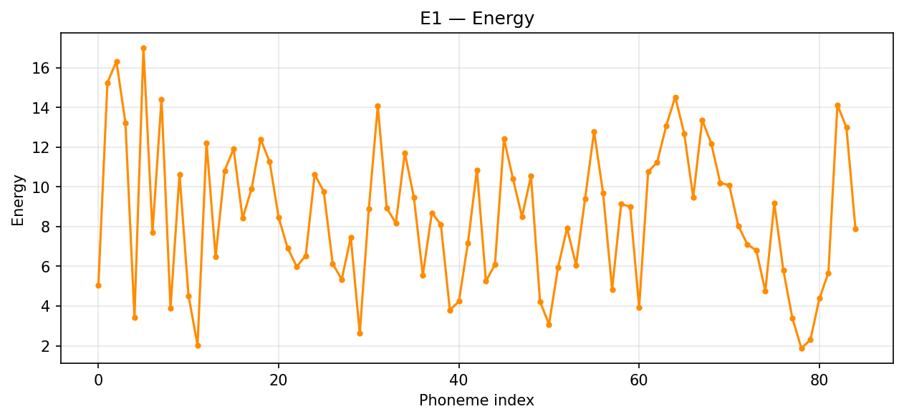<br><sub><code>E1_energy.png</code></sub></td>
</tr>
</table>

<table width="100%">
<tr>
<td width="50%" align="center" valign="top"><b>E2A Energy</b><br><br>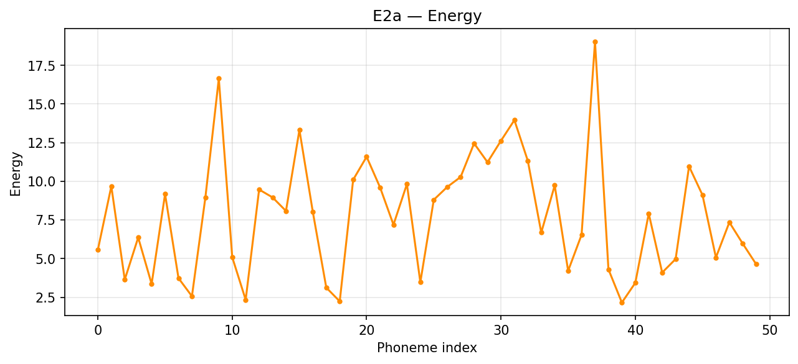<br><sub><code>E2a_energy.png</code></sub></td>
<td width="50%" align="center" valign="top"><b>E2B Energy</b><br><br>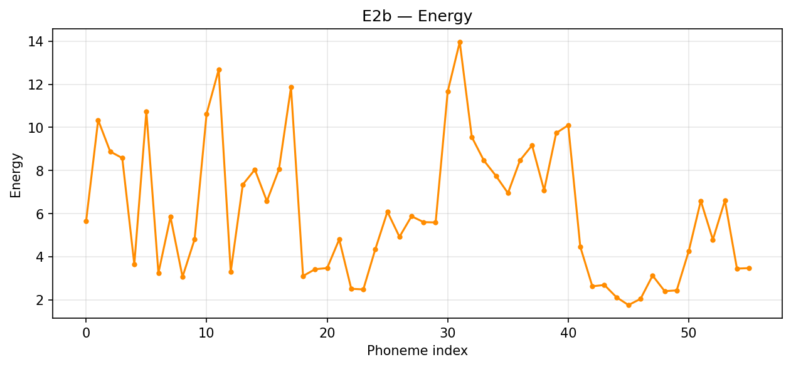<br><sub><code>E2b_energy.png</code></sub></td>
</tr>
</table>

<table width="100%">
<tr>
<td width="50%" align="center" valign="top"><b>E3 Energy</b><br><br>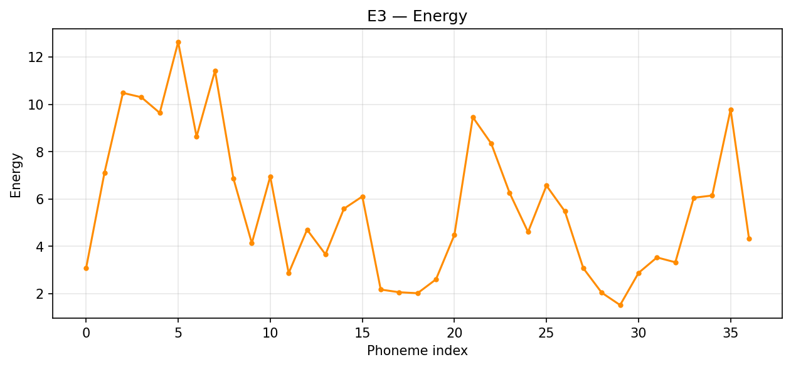<br><sub><code>E3_energy.png</code></sub></td>
<td width="50%" align="center" valign="top"><b>E4 Energy</b><br><br>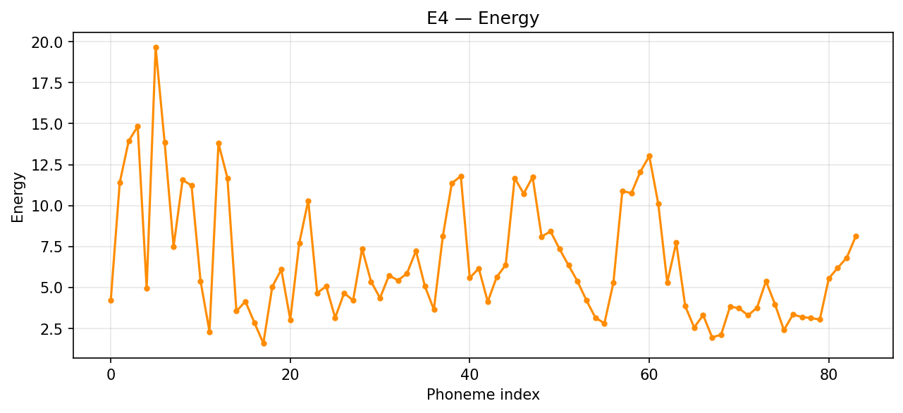<br><sub><code>E4_energy.png</code></sub></td>
</tr>
</table>

<table width="100%">
<tr>
<td width="50%" align="center" valign="top"><b>E1 Pitch</b><br><br>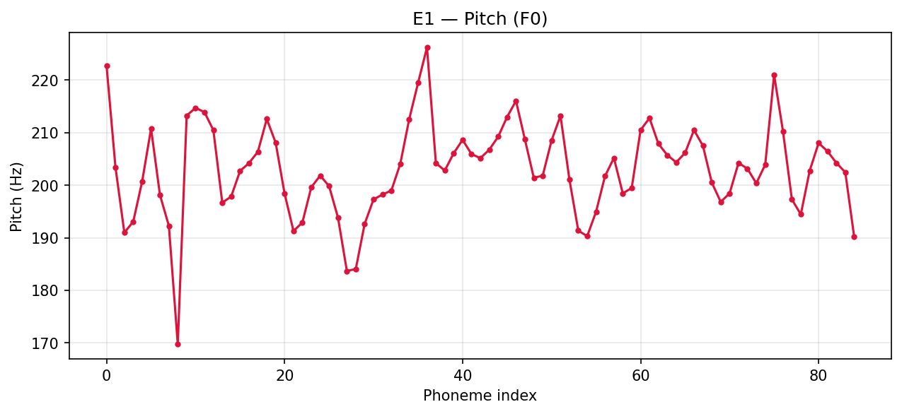<br><sub><code>E1_pitch.png</code></sub></td>
<td width="50%" align="center" valign="top"><b>E2A Pitch</b><br><br>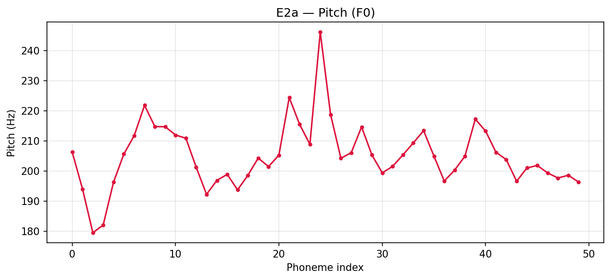<br><sub><code>E2a_pitch.png</code></sub></td>
</tr>
</table>

<table width="100%">
<tr>
<td width="50%" align="center" valign="top"><b>E2B Pitch</b><br><br>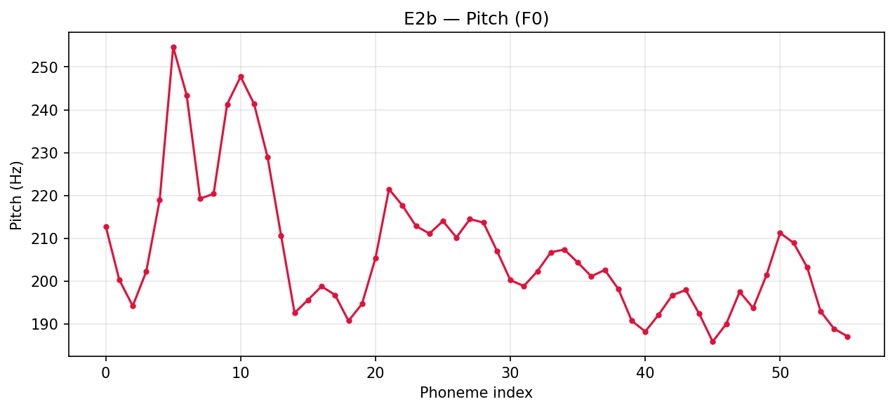<br><sub><code>E2b_pitch.png</code></sub></td>
<td width="50%" align="center" valign="top"><b>E3 Pitch</b><br><br>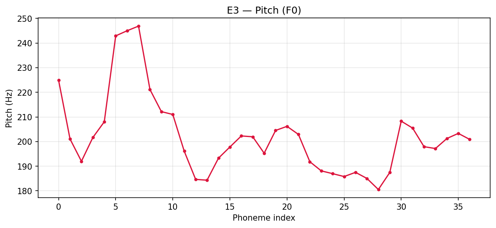<br><sub><code>E3_pitch.png</code></sub></td>
</tr>
</table>

<table width="100%">
<tr>
<td width="50%" align="center" valign="top"><b>E4 Pitch</b><br><br>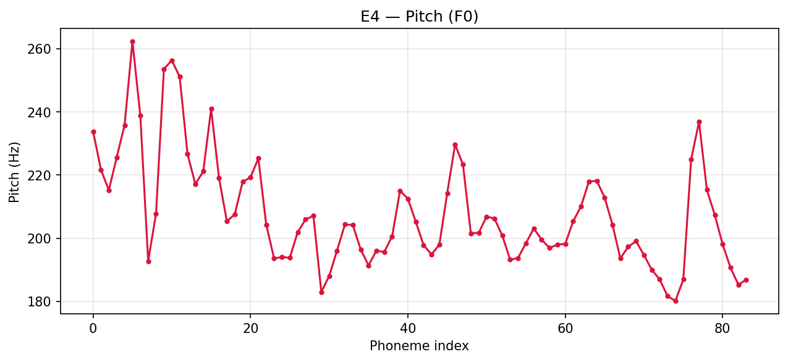<br><sub><code>E4_pitch.png</code></sub></td>
<td width="50%"></td>
</tr>
</table>

</details>

### Telugu

<details open>
<summary><b>Training Loss</b></summary>

<table width="100%">
<tr>
<td width="50%" align="center" valign="top"><b>Training Loss</b><br><br>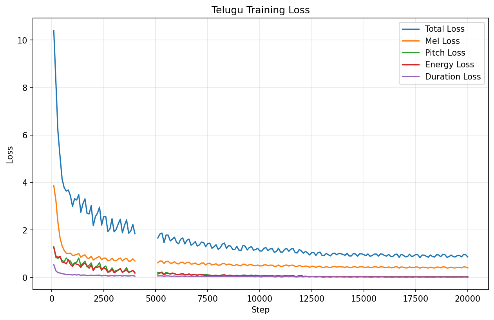<br><sub><code>training_loss.png</code></sub></td>
<td width="50%"></td>
</tr>
</table>

</details>

<details open>
<summary><b>Validation Loss</b></summary>

<table width="100%">
<tr>
<td width="50%" align="center" valign="top"><b>Validation Loss</b><br><br>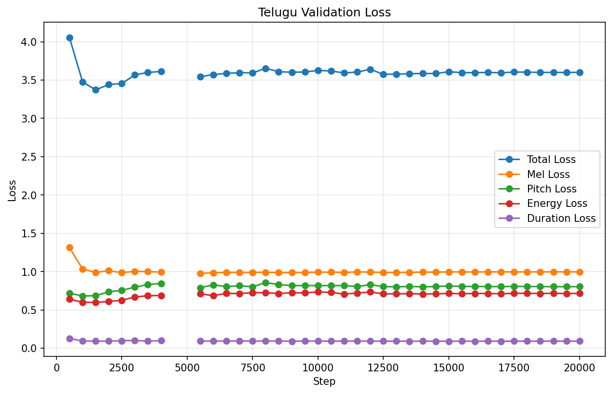<br><sub><code>validation_loss.png</code></sub></td>
<td width="50%"></td>
</tr>
</table>

</details>

---

## 2. Variance Adaptor Visualizations

FastSpeech 2 models speech-related variation through three important
predictors: duration, pitch, and energy.

### English — Variance Analysis

<details>
<summary><b>Duration</b> — 5 visualization(s)</summary>

<table width="100%">
<tr>
<td width="50%" align="center" valign="top"><b>E1 Duration</b><br><br><br><sub><code>E1_duration.png</code></sub></td>
<td width="50%" align="center" valign="top"><b>E2A Duration</b><br><br><br><sub><code>E2a_duration.png</code></sub></td>
</tr>
</table>

<table width="100%">
<tr>
<td width="50%" align="center" valign="top"><b>E2B Duration</b><br><br><br><sub><code>E2b_duration.png</code></sub></td>
<td width="50%" align="center" valign="top"><b>E3 Duration</b><br><br><br><sub><code>E3_duration.png</code></sub></td>
</tr>
</table>

<table width="100%">
<tr>
<td width="50%" align="center" valign="top"><b>E4 Duration</b><br><br><br><sub><code>E4_duration.png</code></sub></td>
<td width="50%"></td>
</tr>
</table>

</details>

<details>
<summary><b>Pitch</b> — 5 visualization(s)</summary>

<table width="100%">
<tr>
<td width="50%" align="center" valign="top"><b>E1 Pitch</b><br><br><br><sub><code>E1_pitch.png</code></sub></td>
<td width="50%" align="center" valign="top"><b>E2A Pitch</b><br><br><br><sub><code>E2a_pitch.png</code></sub></td>
</tr>
</table>

<table width="100%">
<tr>
<td width="50%" align="center" valign="top"><b>E2B Pitch</b><br><br><br><sub><code>E2b_pitch.png</code></sub></td>
<td width="50%" align="center" valign="top"><b>E3 Pitch</b><br><br><br><sub><code>E3_pitch.png</code></sub></td>
</tr>
</table>

<table width="100%">
<tr>
<td width="50%" align="center" valign="top"><b>E4 Pitch</b><br><br><br><sub><code>E4_pitch.png</code></sub></td>
<td width="50%"></td>
</tr>
</table>

</details>

<details>
<summary><b>Energy</b> — 5 visualization(s)</summary>

<table width="100%">
<tr>
<td width="50%" align="center" valign="top"><b>E1 Energy</b><br><br><br><sub><code>E1_energy.png</code></sub></td>
<td width="50%" align="center" valign="top"><b>E2A Energy</b><br><br><br><sub><code>E2a_energy.png</code></sub></td>
</tr>
</table>

<table width="100%">
<tr>
<td width="50%" align="center" valign="top"><b>E2B Energy</b><br><br><br><sub><code>E2b_energy.png</code></sub></td>
<td width="50%" align="center" valign="top"><b>E3 Energy</b><br><br><br><sub><code>E3_energy.png</code></sub></td>
</tr>
</table>

<table width="100%">
<tr>
<td width="50%" align="center" valign="top"><b>E4 Energy</b><br><br><br><sub><code>E4_energy.png</code></sub></td>
<td width="50%"></td>
</tr>
</table>

</details>

### Telugu — Variance Analysis

_No variance-adaptor plots found yet._

---

## 3. Generated Speech Samples

The following files are the generated audio outputs available in the repository.

### English Speech Samples

| Sample | Audio file |
|---|---|
| Sample 1 | [▶ Listen / Open](Results/English/test_generated_audios/E1.wav) |
| Sample 2 | [▶ Listen / Open](Results/English/test_generated_audios/E2a.wav) |
| Sample 3 | [▶ Listen / Open](Results/English/test_generated_audios/E2b.wav) |
| Sample 4 | [▶ Listen / Open](Results/English/test_generated_audios/E3.wav) |
| Sample 5 | [▶ Listen / Open](Results/English/test_generated_audios/E4.wav) |


### Telugu Speech Samples

_No generated audio files found yet._


---

## 4. Results Directory

| Language | Training graphs | Variance plots | Audio samples |
|---|---:|---:|---:|
| English | 23 | 15 | 5 |
| Telugu | 2 | 0 | 0 |

## Installation

### 1. Clone the repository

```bash
git clone https://github.com/Hanushree29/fastspeech2-tts-english-telugu.git
cd fastspeech2-tts-english-telugu
```

### 2. Install dependencies

```bash
pip install -r requirements.txt
```

Use the Python and PyTorch versions compatible with the implementation and your hardware environment.

## Reproducibility

Each language implementation is maintained independently. For an experiment:

1. Prepare the corresponding language dataset.
2. Review the language-specific preprocessing configuration.
3. Run the preprocessing pipeline.
4. Review the model and training configuration.
5. Train or load the relevant model checkpoint.
6. Run inference using the language-specific pipeline.
7. Save generated audio and experiment visualizations under `Results/`.

Consult the configuration files in each language directory for the actual parameter values. Download links for model checkpoints are provided above.

## Technical Report

The `Report/` directory is reserved for the technical documentation of the implementation and experiments.

## Acknowledgements

- [FastSpeech 2](https://arxiv.org/abs/2006.04558) — Non-autoregressive speech synthesis architecture.
- [AI4Bharat](https://ai4bharat.org/) — Indian-language AI research and resources.
- [HiFi-GAN](https://github.com/jik876/hifi-gan) — Neural vocoder.

## Author

**Hanushree M**

[GitHub](https://github.com/Hanushree29)

---

<p align="center">
  <b>Multilingual FastSpeech 2 · English & Telugu</b><br>
  Research implementation and experimental outputs
</p>
