# FastSpeech 2 — English and Telugu Text-to-Speech

<p align="center">
  <strong>A multilingual neural text-to-speech implementation using FastSpeech 2</strong>
</p>

<p align="center">
  English | తెలుగు
</p>

<p align="center">
  <a href="https://github.com/Hanushree29/fastspeech2-tts-english-telugu">GitHub</a> ·
  <a href="https://huggingface.co/Hanushree/fastspeech2-svarah-english">English Models</a> ·
  <a href="https://huggingface.co/Hanushree/fastspeech2-telugu-v2">Telugu Models</a>
</p>

---

## 1. Overview

This repository presents an implementation of **FastSpeech 2** for
neural text-to-speech synthesis in English and Telugu.

The project maintains independent language pipelines for dataset
preparation, text processing, acoustic feature extraction, training,
inference, and result analysis.

The objective is to generate intelligible speech from text while
investigating the role of duration, pitch, and energy prediction
in neural speech synthesis.

### Project highlights

- Separate English and Telugu implementations.
- FastSpeech 2 acoustic model.
- Language-specific text and phoneme processing.
- Duration, pitch, and energy prediction.
- Mel-spectrogram generation.
- HiFi-GAN waveform synthesis.
- Training and validation loss analysis.
- Generated speech samples.
- Variance-adaptor visualizations.
- External checkpoint hosting.

## 2. Architecture

FastSpeech 2 is a non-autoregressive text-to-speech architecture.
It uses explicit variance information to model speech duration,
pitch, and energy.

```text
             Input Text
                 |
          Text Processing
                 |
          Phoneme Sequence
                 |
              Encoder
                 |
          Variance Adaptor
          /      |       \
     Duration  Pitch    Energy
          \      |       /
           Length Regulator
                 |
              Decoder
                 |
          Mel-Spectrogram
                 |
              HiFi-GAN
                 |
          Generated Speech
```

### Architecture components

| Component | Responsibility |
|---|---|
| Text processing | Converts text into model-compatible representations |
| Encoder | Extracts contextual text representations |
| Duration predictor | Predicts phoneme duration |
| Pitch predictor | Predicts pitch features |
| Energy predictor | Predicts energy features |
| Length regulator | Expands representations using predicted duration |
| Decoder | Generates mel-spectrograms |
| HiFi-GAN | Converts mel-spectrograms into waveforms |

## 3. Datasets

| Language | Dataset | Application |
|---|---|---|
| English | AI4Bharat Svarah | English speech synthesis |
| Telugu | IndicTTS Telugu | Telugu speech synthesis |

### English preprocessing

The English pipeline includes audio and transcript preparation,
duration filtering, acoustic feature extraction, and dataset
organization for training and validation.

The documented training subset contains approximately 5.01 hours
of audio, with approximately 0.99 hours used for validation.

### Telugu preprocessing

The Telugu pipeline includes:

- Audio and transcript processing.
- Telugu text and phoneme preparation.
- Acoustic feature extraction.
- Duration, pitch, and energy target preparation.
- Training and validation data preparation.

## 4. Training Configuration

The two languages use independent configuration files.

| Setting | English | Telugu |
|---|---|---|
| Architecture | FastSpeech 2 | FastSpeech 2 |
| Dataset | Svarah | IndicTTS Telugu |
| Acoustic representation | Mel-spectrogram | Mel-spectrogram |
| Vocoder | Universal HiFi-GAN | Universal HiFi-GAN |
| Sample rate | 22,050 Hz | 22,050 Hz |
| Training environment | Kaggle GPU | Kaggle GPU |
| Latest documented checkpoint | 30,000 steps | 20,000 steps |

Refer to the respective `config/` directories for model,
preprocessing, and training configurations.

## 5. Repository Organization

```text
fastspeech2-tts-english-telugu/
│
├── English/
│   ├── audio/
│   ├── checkpoints/
│   ├── config/
│   ├── hifigan/
│   ├── lexicon/
│   ├── model/
│   ├── text/
│   ├── utils/
│   ├── dataset.py
│   ├── inference.py
│   ├── preprocess.py
│   └── train.py
│
├── Telugu/
│   ├── audio/
│   ├── checkpoints/
│   ├── config/
│   ├── hifigan/
│   ├── lexicon/
│   ├── model/
│   ├── preprocessor/
│   ├── text/
│   ├── transformer/
│   ├── utils/
│   ├── dataset.py
│   ├── inference.py
│   ├── preprocess.py
│   └── train.py
│
├── Results/
│   ├── English/
│   └── Telugu/
│
├── Report/
├── README.md
└── requirements.txt
```


## English Experiment Results

### Training Loss


### Validation Loss


### Checkpoint Progression


### Generated English Speech

- [E1.wav](Results/English/test_generated_audios/E1.wav)
- [E2a.wav](Results/English/test_generated_audios/E2a.wav)
- [E2b.wav](Results/English/test_generated_audios/E2b.wav)
- [E3.wav](Results/English/test_generated_audios/E3.wav)
- [E4.wav](Results/English/test_generated_audios/E4.wav)

### English Variance Adaptor Visualizations


## Telugu Experiment Results

### Training Loss


### Validation Loss


### Model Weight Distribution

_Result image not yet available._
### Module Parameter Distribution

_Result image not yet available._
### Duration Comparison

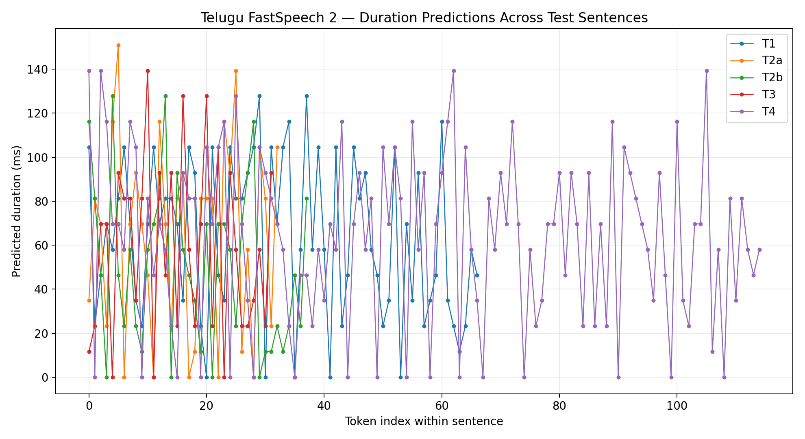
### Pitch Comparison

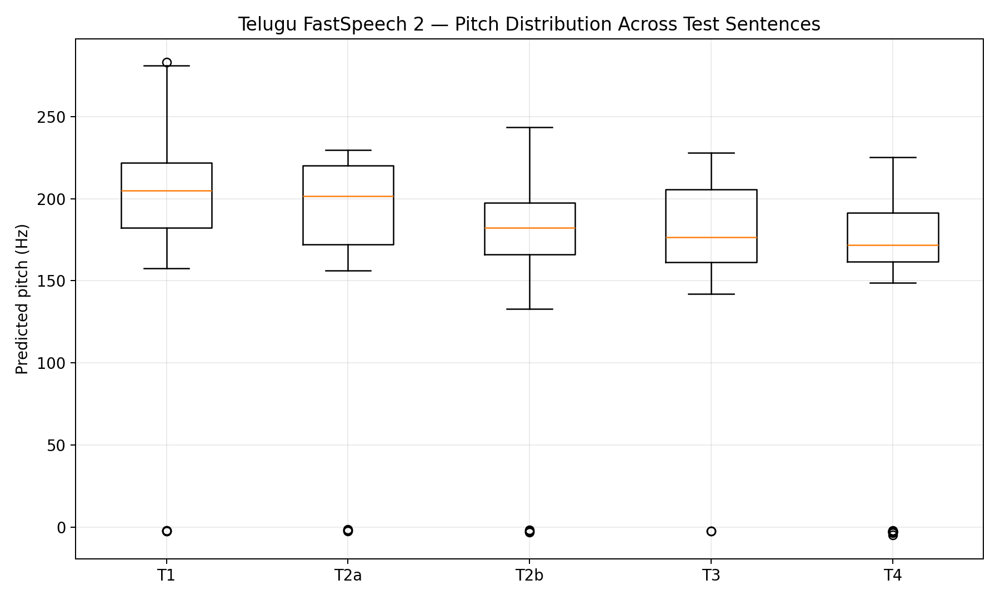
### Energy Comparison

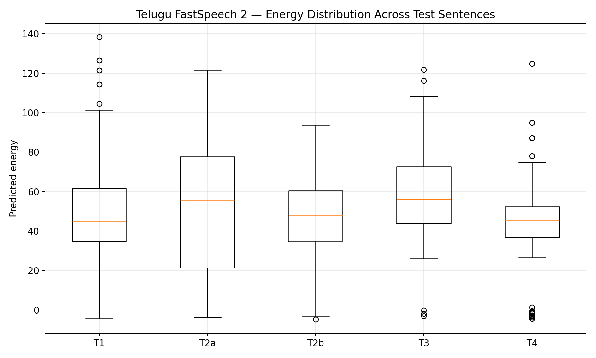

### Generated Telugu Speech

- [T1.wav](Results/Telugu/test_generated_audios/T1.wav)
- [T2a.wav](Results/Telugu/test_generated_audios/T2a.wav)
- [T2b.wav](Results/Telugu/test_generated_audios/T2b.wav)
- [T3.wav](Results/Telugu/test_generated_audios/T3.wav)
- [T4.wav](Results/Telugu/test_generated_audios/T4.wav)
- [T4_enhanced.wav](Results/Telugu/test_generated_audios/T4_enhanced.wav)

### Telugu Variance Adaptor Plots

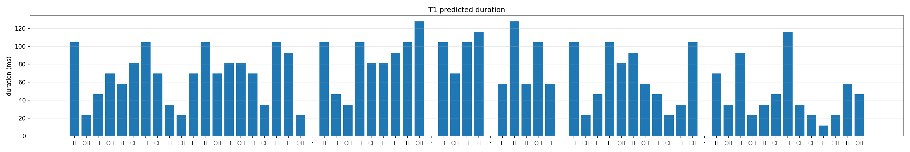

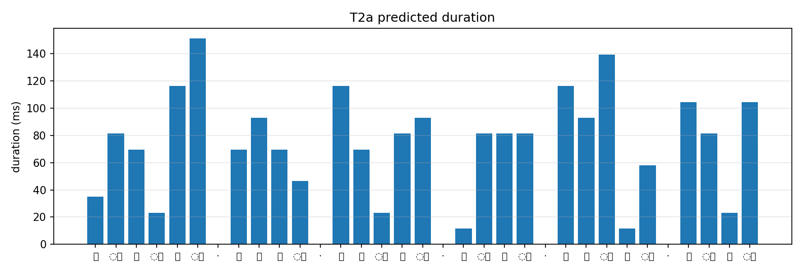

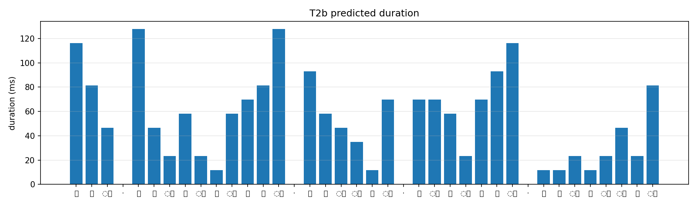

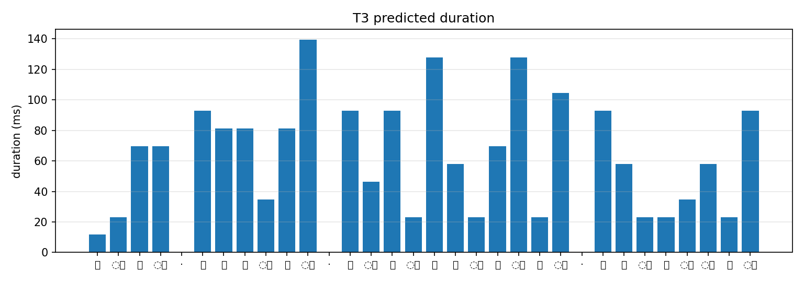

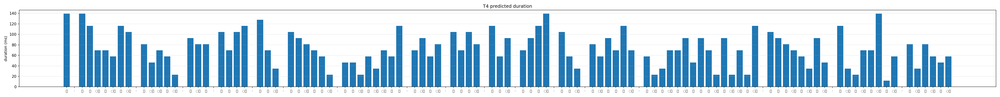

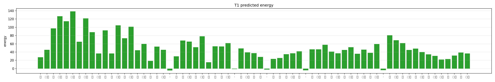

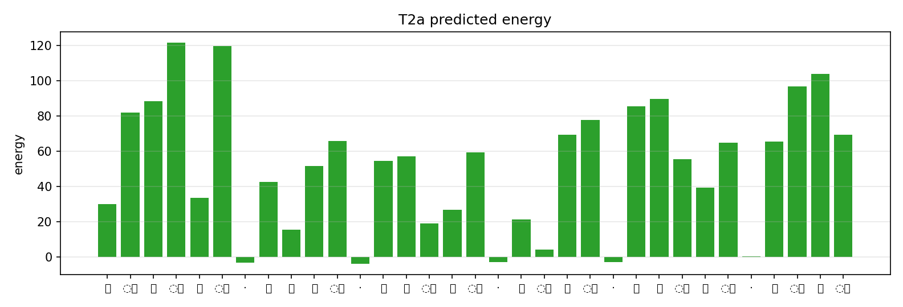

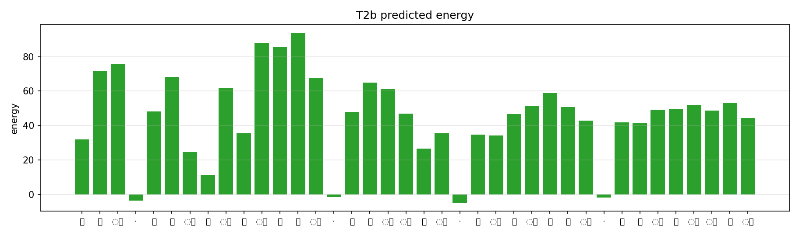

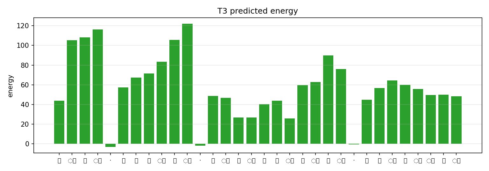

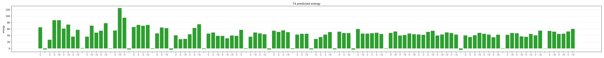

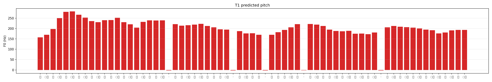

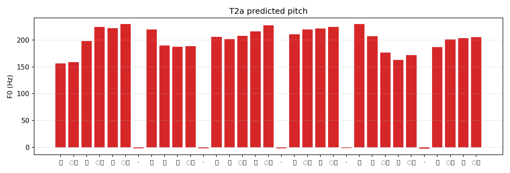

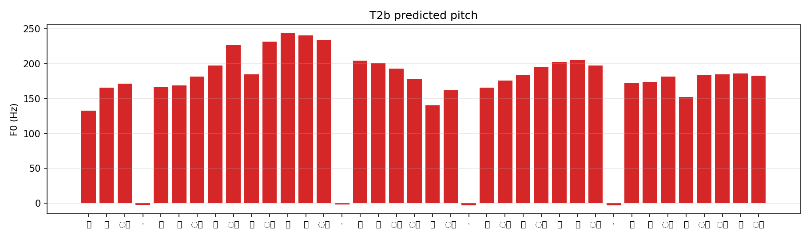

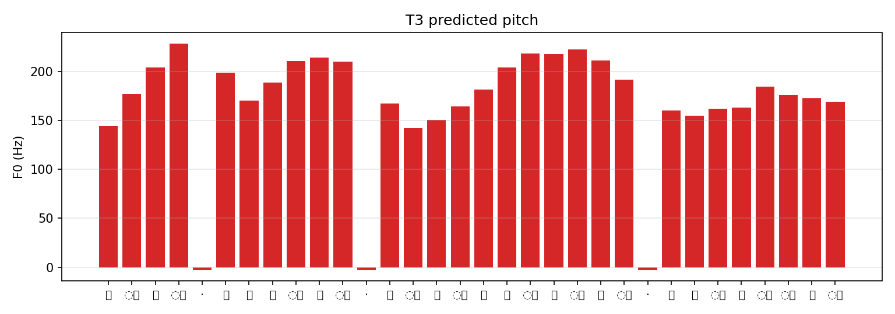

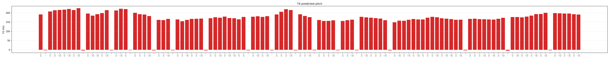


## Technical Report

The technical report documents the architecture, datasets,
preprocessing pipeline, training methodology, experimental
results, and analysis.

_Report PDF is not yet present in the repository._

## Model Checkpoints

Model checkpoints are hosted on Hugging Face to avoid GitHub
large-file limitations.

- [English FastSpeech 2 Checkpoints](https://huggingface.co/Hanushree/fastspeech2-svarah-english)
- [Telugu FastSpeech 2 Checkpoints](https://huggingface.co/Hanushree/fastspeech2-telugu-v2)

For Telugu checkpoint download links, see
[Telugu/checkpoints/README.md](Telugu/checkpoints/README.md).


## 7. Installation

Clone the repository:

```bash
git clone https://github.com/Hanushree29/fastspeech2-tts-english-telugu.git
cd fastspeech2-tts-english-telugu
```

Install dependencies:

```bash
pip install -r requirements.txt
```

A compatible Python and PyTorch environment, along with the
required audio-processing dependencies, is needed.

## 8. Running the Pipelines

The English and Telugu pipelines are maintained independently.

### English

```bash
cd English
python preprocess.py
python train.py
python inference.py
```

### Telugu

```bash
cd Telugu
python preprocess.py
python train.py
python inference.py
```

Check each script's argument parser and language-specific YAML
configuration before executing. Dataset paths and preprocessing
artifacts must be configured for the local environment.

## 9. Checkpoint Hosting

Large model checkpoints are hosted externally rather than committed
to GitHub.

The checkpoint repositories provide access to the trained models
and their respective training stages.

## 10. Implementation Notes

The implementation is based on the
[ming024/FastSpeech2](https://github.com/ming024/FastSpeech2)
reference repository.

Language-specific adaptations include text processing,
configuration management, dataset preparation, training,
checkpoint handling, and inference.

## 11. Limitations and Future Work

The current implementations are experimental.

Future improvements include:

1. Improving speech naturalness and pronunciation.
2. Better handling of long utterances.
3. Expanding Telugu phoneme and pronunciation coverage.
4. Improving number, date, and time normalization.
5. Evaluating generalization across speakers and unseen sentences.
6. Adding objective speech-quality metrics and human evaluation.

## 12. References

1. Ren et al. (2020), [FastSpeech 2: Fast and High-Quality End-to-End Text to Speech](https://arxiv.org/abs/2006.04558).
2. [FastSpeech 2 reference implementation](https://github.com/ming024/FastSpeech2).
3. [AI4Bharat Svarah dataset](https://huggingface.co/datasets/ai4bharat/Svarah).
4. [AI4Bharat](https://ai4bharat.iitm.ac.in/).
5. [HiFi-GAN](https://github.com/jik876/hifi-gan).

---

## Author

**Hanushree M**

B.E. Computer Science and Engineering

[GitHub Profile](https://github.com/Hanushree29)

[Project Repository](https://github.com/Hanushree29/fastspeech2-tts-english-telugu)
